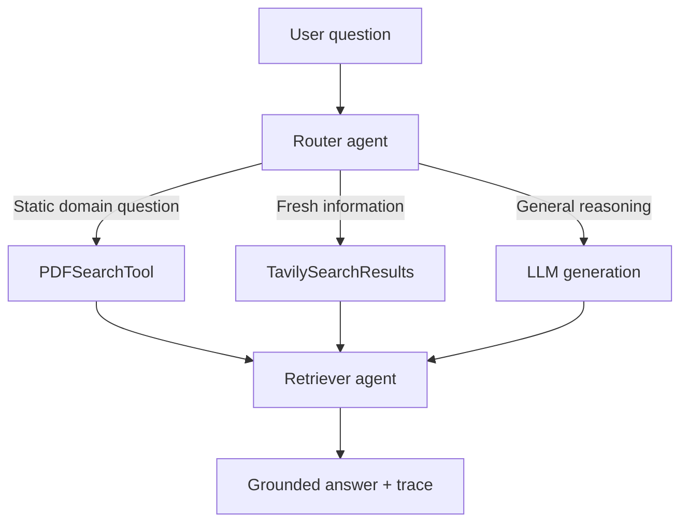

# Agentic RAG Multi-Agent System

A course-ready demonstration of a multi-agent question-answering system built around **CrewAI**. A router agent selects one of three paths—PDF retrieval, live web retrieval, or direct LLM generation—and a retriever agent produces a grounded answer with source metadata and JSONL trace logs.

## Architecture



| Component | Responsibility |
| --- | --- |
| Router agent | Classifies the question as `pdf`, `web`, or `generate` and records the decision. |
| Retriever agent | Invokes the selected tool, synthesizes an answer, and preserves citations/source metadata. |
| PDF tool | Searches the supplied domain PDF with `crewai_tools.PDFSearchTool`. |
| Web tool | Retrieves fresh information with `TavilySearchResults`. |
| Trace logger | Writes timestamped routing, retrieval, and answer events to JSONL. |

CrewAI was selected because it gives each agent a distinct role, goal, and tool set while keeping sequential collaboration easy to inspect. The explicit handoff also makes routing decisions and retrieval results easier to test than a single opaque prompt.

## Quick start

1. Create a Python 3.10+ virtual environment.
2. Install dependencies:

   ```bash
   pip install -r requirements.txt
   ```

3. Copy `.env.example` to `.env` and add `OPENAI_API_KEY` and `TAVILY_API_KEY`.
4. Put the paper or another domain PDF at `data/attention_is_all_you_need.pdf`.
5. Open `Agentic_RAG_Multi_Agent_Demo.ipynb` and run all cells.

The notebook begins with a deterministic offline demonstration, so reviewers can see both PDF and web routing without API keys. The live cells are opt-in and use the required CrewAI, PDFSearchTool, and Tavily integrations.

## Run from Python

```python
from pathlib import Path
from src.agentic_rag import AgenticRAGSystem

system = AgenticRAGSystem(
    pdf_path=Path("data/attention_is_all_you_need.pdf"),
    trace_path=Path("logs/trace.jsonl"),
)

decision = system.route("What is multi-head attention?")
print(decision)
```

For a live CrewAI run:

```python
crew = system.build_crew("What recent work improves Transformer efficiency?")
result = crew.kickoff()
print(result)
```

## Input-output flow

1. The system accepts a natural-language question.
2. The router returns a structured `RouteDecision`.
3. The selected source is searched.
4. The retriever receives the question, route, and evidence.
5. The final answer cites or identifies the evidence used.
6. Each stage appends an event to the trace file.

## Challenges and trade-offs

- **Reliable routing:** Keyword rules are deterministic for the offline demo; the live router uses an LLM for broader language coverage. Rules are easier to test but less flexible.
- **Reproducibility:** Web results change. Traces capture the query, tool, and retrieved metadata so a run can be reviewed later.
- **PDF setup cost:** Semantic PDF search requires embedding/index creation. It improves passage matching but makes the first live run slower.
- **Secrets:** API keys stay in `.env`, which is excluded from Git. The executed demo contains no credentials.
- **Grounding:** The retriever is instructed to say when evidence is insufficient rather than filling gaps from memory.

## Repository layout

```text
Agentic_RAG_Multi_Agent_Demo.ipynb  Executed demonstration
src/agentic_rag.py                  Orchestration and tool adapters
tests/test_router.py                Deterministic routing tests
logs/demo_trace.jsonl               Example interaction trace
data/README.md                      Dataset instructions
requirements.txt                    Python dependencies
.env.example                        Required environment variables
```

## License

Code is released under the MIT License. The referenced paper is not bundled; download it from its official source and observe its own license.
